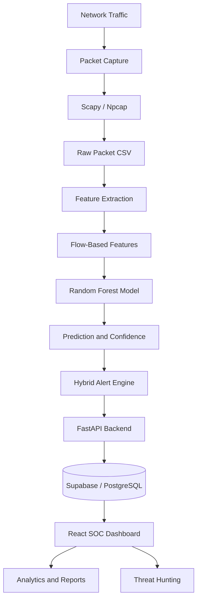
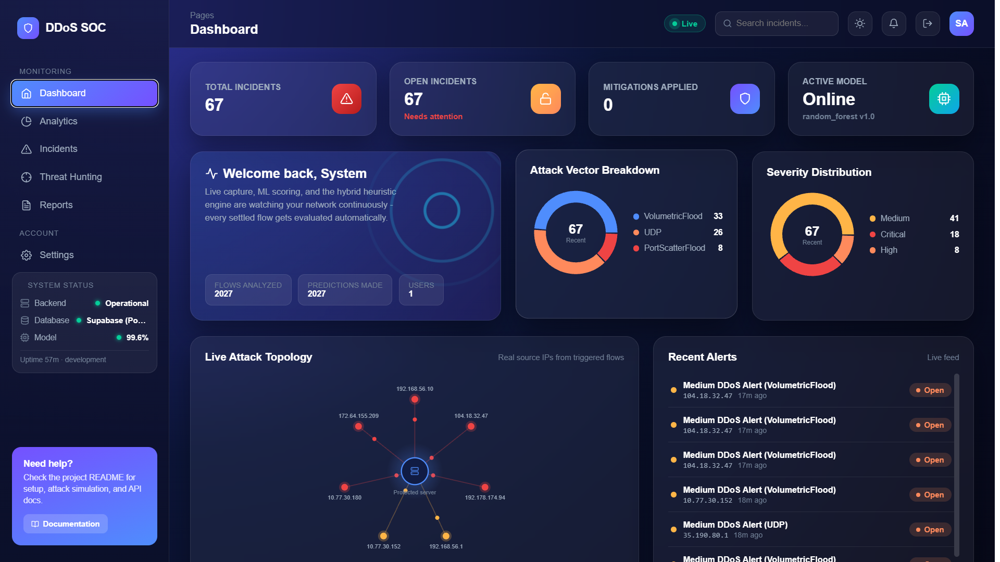
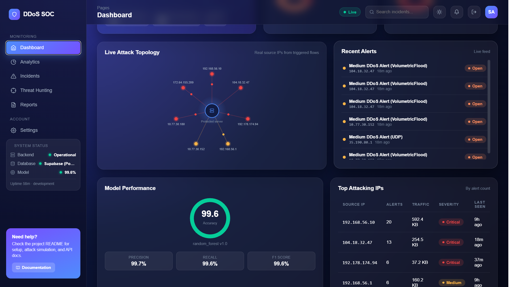
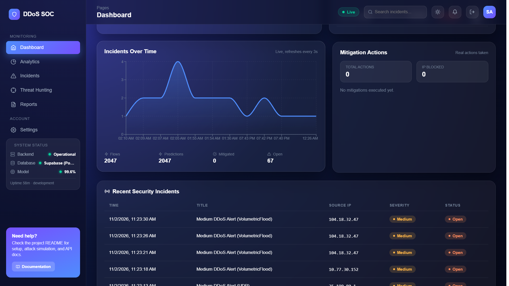
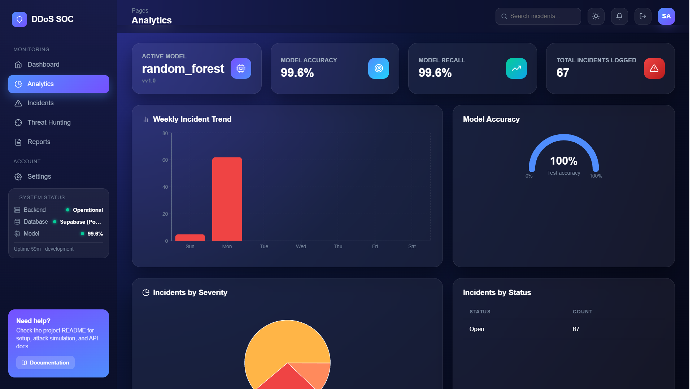
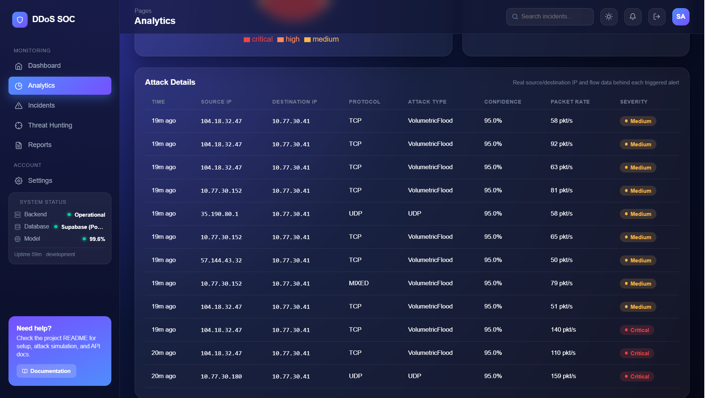
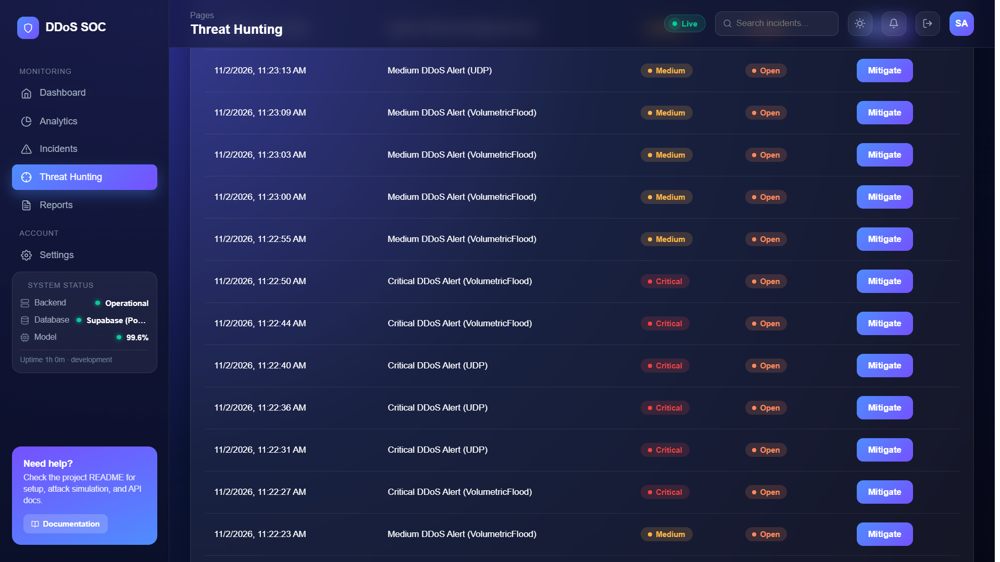
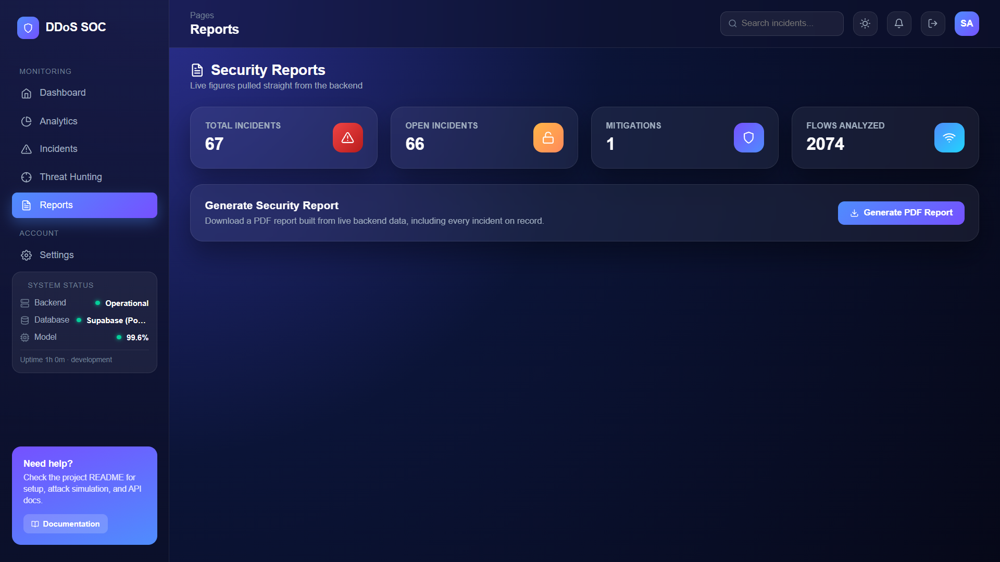
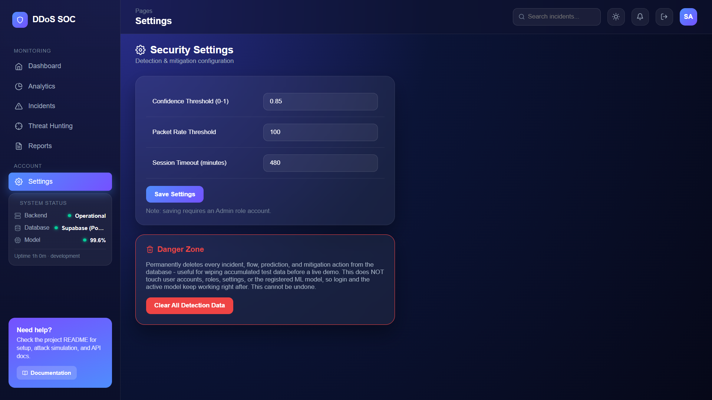
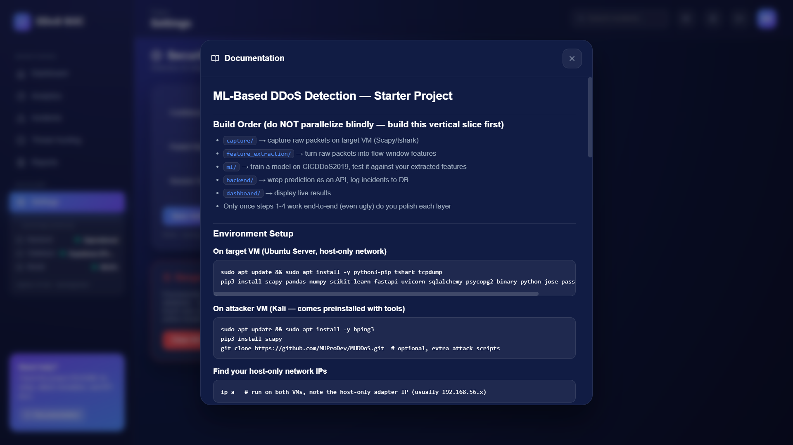

<div align="center">

# 🛡️ ML-Based DDoS Detection System

### Intelligent Network Traffic Monitoring & DDoS Detection Using Machine Learning

An ML-powered Security Operations Center (SOC) dashboard that captures network traffic, extracts flow-based features, detects suspicious activity using a Random Forest classifier, and visualizes security incidents in real time.

<br>


</div>

---

# 📌 Table of Contents

- [Project Overview](#-project-overview)
- [Objectives](#-project-objectives)
- [Key Features](#-key-features)
- [System Architecture](#-system-architecture)
- [Technology Stack](#-technology-stack)
- [Machine Learning Model](#-machine-learning-model)
- [Dashboard Preview](#-dashboard-preview)
- [Project Structure](#-project-structure)
- [Installation and Setup](#-installation-and-setup)
- [Running the Project](#-running-the-project)
- [Detection Methodology](#-detection-methodology)
- [Dataset](#-dataset)
- [Model Evaluation](#-model-evaluation)
- [Testing](#-testing)
- [Security Considerations](#-security-considerations)
- [Future Scope](#-future-scope)
- [Contributors](#-contributors)

---

# 🚀 Project Overview

The **ML-Based DDoS Detection System** is a machine-learning-assisted network security platform designed to identify suspicious traffic patterns and potential Distributed Denial-of-Service (DDoS) activity.

Traditional network monitoring systems often depend on fixed rules and predefined signatures. This project combines machine-learning classification with a rule-based alert engine to analyze network traffic and identify potentially malicious behavior.

The system continuously captures packets, converts them into flow-level features, processes them through a trained Random Forest model, and sends qualifying detections to a FastAPI backend.

A React-based SOC dashboard provides a centralized interface for monitoring security incidents, analyzing attack vectors, investigating source IP addresses, and reviewing system performance.

## 🎯 Project Objectives

- Develop a real-time network traffic monitoring system.
- Apply machine learning to classify network traffic.
- Identify suspicious traffic patterns associated with DDoS activity.
- Extract meaningful network-flow features from captured packets.
- Generate alerts using model predictions and detection heuristics.
- Store incident information in a backend database.
- Visualize detected events through an interactive SOC dashboard.
- Provide analytics and security reports for investigation.

---

# ✨ Key Features

### 1. Live Packet Capture

- Packet capture using Scapy and Npcap.
- Monitoring of selected network interfaces.
- Collection of source IP, destination IP, protocol, ports, packet size, and TCP flags.
- Raw packet logging for subsequent feature extraction.

### 2. Machine Learning Detection

- Random Forest classification model.
- CIC-DDoS2019-based training workflow.
- Flow-based feature extraction.
- Prediction confidence and attack-probability calculation.
- Classification of supported network traffic categories.

### 3. Hybrid Alert Engine

- ML-based prediction evaluation.
- Configurable confidence threshold.
- Configurable packet-rate threshold.
- Rule-based traffic-pattern heuristics.
- Incident severity classification.

### 4. Backend and Database

- FastAPI-based REST API.
- Authentication and authorization.
- Alert evaluation endpoint.
- Persistent incident and flow records.
- Supabase/PostgreSQL database integration.

### 5. Interactive SOC Dashboard

- Real-time monitoring interface.
- Attack-vector breakdown.
- Severity distribution.
- Live attack topology.
- Recent security alerts.
- Threat hunting and incident investigation.
- Security analytics and report generation.
- Detection configuration settings.

---

# 🏗️ System Architecture

The project follows an end-to-end network traffic analysis pipeline.



## Detection Workflow

| Stage | Description |
|---|---|
| Packet Capture | Captures network packets from the selected interface |
| Feature Extraction | Converts packets into flow-based numerical features |
| ML Classification | Predicts the network traffic category |
| Alert Evaluation | Evaluates predictions and traffic characteristics |
| Backend Processing | Receives and processes qualifying alerts |
| Database Storage | Stores incident and flow information |
| Dashboard | Displays alerts, analytics, and security events |

---

# 💻 Technology Stack

| Component | Technology |
|---|---|
| Programming Language | Python |
| Packet Capture | Scapy, Npcap |
| Data Processing | Pandas, NumPy |
| Machine Learning | Scikit-learn |
| ML Algorithm | Random Forest |
| Dataset | CIC-DDoS2019 |
| Backend | FastAPI |
| API Server | Uvicorn |
| Database | Supabase / PostgreSQL |
| ORM | SQLAlchemy |
| Frontend | React |
| Frontend Build Tool | Vite |
| Development Environment | Windows 11 / Linux |
| Version Control | Git and GitHub |

---

# 🤖 Machine Learning Model

The system uses a **Random Forest Classifier** trained using network traffic data from the CIC-DDoS2019 dataset.

The model analyzes flow-level network characteristics to classify traffic into the categories represented in its training labels.

### Model Input Features

The current pipeline uses 11 flow-level features:

| No. | Feature |
|---:|---|
| 1 | Flow Duration |
| 2 | Total Forward Packets |
| 3 | Total Backward Packets |
| 4 | Forward Packets Length Total |
| 5 | Backward Packets Length Total |
| 6 | Flow Bytes per Second |
| 7 | Flow Packets per Second |
| 8 | SYN Flag Count |
| 9 | ACK Flag Count |
| 10 | Packet Length Mean |
| 11 | Flow IAT Mean |

### Prediction Process

1. Captured packets are grouped into flow windows.
2. Numerical flow features are extracted.
3. Features are arranged in the model's expected column order.
4. The Random Forest model generates predictions.
5. Prediction probabilities are calculated.
6. The alert engine evaluates the prediction and traffic rate.
7. Qualifying events are submitted to the backend.

The alert engine uses separate detection conditions. Therefore, a model prediction does not automatically become a stored security incident.

---

# 📸 Dashboard Preview

The following screenshots show the major modules of the DDoS SOC dashboard.

## 1. Dashboard Overview

The main dashboard provides incident statistics, active model status, severity distribution, recent alerts, and attack-vector information.



## 2. Live Attack Topology

Visualizes source IP addresses and their relationships with the protected server, alongside recent alerts and top attacking IP statistics.



## 3. Incident Timeline and Mitigations

Displays incident activity over time, mitigation statistics, and recent security incidents.



## 4. Security Analytics

Provides model information, incident trends, accuracy indicators, severity distribution, and incident status summaries.



## 5. Attack Details

Displays detailed information for triggered alerts, including source IP, destination IP, protocol, attack type, confidence, packet rate, and severity.



## 6. Threat Hunting

Provides an investigation interface for reviewing security alerts, severity levels, incident status, and mitigation actions.



## 7. Security Reports

Summarizes incident totals, open incidents, mitigations, analyzed flows, and PDF report generation.



## 8. Security Settings

Allows administrators to configure detection confidence, packet-rate thresholds, and session timeout settings.



## 9. In-App Documentation

Provides setup instructions and project workflow guidance directly inside the application.



> Screenshot values represent application state captured during lab demonstrations. They are not independent benchmark results.

---

# 📁 Project Structure

```text
ddos-detection/
│
├── capture/
│   └── Live packet capture scripts
│
├── feature_extraction/
│   └── Flow feature extraction utilities
│
├── ml/
│   ├── Model training scripts
│   ├── Live monitoring
│   ├── Prediction pipeline
│   └── Feature processing
│
├── models/
│   ├── random_forest_v1.0.joblib
│   └── random_forest_v1.0_metadata.json
│
├── backend/
│   └── app/
│       ├── api/
│       ├── core/
│       ├── models/
│       ├── schemas/
│       └── services/
│
├── frontend/
│   ├── src/
│   ├── public/
│   └── package.json
│
├── scripts/
│   └── Lab and testing utilities
│
├── data/
│   └── Dataset and packet data
│
├── docs/
│   ├── screenshots/
│   ├── PBL_Report.md
│   ├── PBL_Report.docx
│   └── Presentation.pptx
│
├── .env.example
├── .gitignore
├── start_project.bat
└── README.md
```

---

# ⚙️ Installation and Setup

## Prerequisites

Install the following software:

- Python 3.11 (recommended)
- Node.js and npm
- Git
- Npcap (Windows packet capture)
- MySQL/PostgreSQL-compatible database configuration as required by the project
- Supabase credentials if using hosted database storage

## 1. Clone the Repository

```bash
git clone https://github.com/akshatcore/ddos-detection.git

cd ddos-detection
```

## 2. Create Python Virtual Environment

### Windows PowerShell

```powershell
py -3.11 -m venv venv

.\venv\Scripts\Activate.ps1

python -m pip install --upgrade pip
```

Install the required Python dependencies:

```powershell
pip install scapy pandas numpy scikit-learn fastapi uvicorn sqlalchemy psycopg2-binary python-jose passlib bcrypt requests joblib
```

If a requirements file is available in the repository, use that file to install the project's pinned dependencies instead.

## 3. Install Frontend Dependencies

```powershell
cd frontend

npm install

cd ..
```

## 4. Configure Environment Variables

Create a local `.env` file using the example configuration:

```powershell
Copy-Item .env.example .env
```

Configure the required database connection, authentication, and application settings.

**Never commit the real `.env` file or expose database credentials, tokens, or secret keys.**

## 5. Prepare the Dataset

The project uses the CIC-DDoS2019 dataset.

Dataset reference:

https://www.unb.ca/cic/datasets/ddos-2019.html

Place the required CSV subset in:

```text
data/cicddos2019/
```

Use reasonably sized CSV files for development and training.

---

# ▶️ Running the Project

## Windows — Recommended Startup

From the project root, execute:

```powershell
.\start_project.bat
```

Follow the startup prompts and select the appropriate network interface IP.

Keep the backend, frontend, and live-monitor processes running during the demonstration.

### Application URLs

| Service | Local Address |
|---|---|
| React Dashboard | http://localhost:5173 |
| FastAPI Backend | http://127.0.0.1:8000 |
| Backend Health | http://127.0.0.1:8000/health |

The actual bind address and ports depend on the local configuration.

## Manual Component Execution

### Start Backend

```bash
python -m uvicorn backend.app.main:app --reload --host 127.0.0.1 --port 8000
```

### Start Frontend

```bash
cd frontend
npm run dev
```

### Start Packet Capture

```bash
python capture/live_capture.py --iface "<interface-name>"
```

### Build Flow Features

```bash
python feature_extraction/build_features.py
```

### Run Live Model Detection

```bash
python ml/detect_live.py
```

### Submit Predictions to Backend

If the current repository version contains `ml/pipeline.py`:

```bash
python ml/pipeline.py --backend-url http://127.0.0.1:8000
```

The live monitor and pipeline entrypoints should be run according to the version present in your checkout. The integrated startup script is the recommended option for the configured Windows setup.

---

# 🔍 Detection Methodology

The system follows a hybrid approach combining machine-learning predictions with rule-based traffic analysis.

### Machine Learning Detection

- Calculates probabilities for the available model classes.
- Identifies the predicted traffic category.
- Calculates prediction confidence and combined attack probability.
- Submits eligible flows to the backend alert evaluator.

### Heuristic Detection

The alert engine can evaluate traffic characteristics such as:

- Packet rate.
- TCP SYN and ACK flag ratios.
- Forward and backward packet counts.
- UDP traffic characteristics.
- Destination-port diversity.

### Alert Severity

The backend assigns severity according to configured detection rules.

| Severity | Description |
|---|---|
| Medium | A qualifying suspicious event |
| High | A higher-risk detection |
| Critical | A detection meeting critical severity conditions |

Detection thresholds can be configured through the application settings.

---

# 📊 Dataset

The project uses the **CIC-DDoS2019 dataset**, developed for research and evaluation of DDoS detection techniques.

Dataset source:

https://www.unb.ca/cic/datasets/ddos-2019.html

The dataset contains network traffic suitable for developing and evaluating machine-learning-based intrusion and DDoS detection models.

Dataset files are kept outside the main Git repository when they are large.

---

# 📈 Model Evaluation

The project includes model evaluation metadata:

```text
models/
├── random_forest_v1.0.joblib
└── random_forest_v1.0_metadata.json
```

The metadata file records the evaluation results associated with the trained model.

Refer to the metadata generated by the training process for verified accuracy, precision, recall, and F1-score values.

**Important:** Offline dataset metrics and live network detection performance measure different things. Live results depend on capture visibility, feature extraction, traffic characteristics, and configured detection thresholds.

---

# 🧪 Testing

Run the backend tests from the project root:

```bash
python -m pytest backend/tests -q
```

For an end-to-end lab validation:

1. Start the backend and verify its health endpoint.
2. Start packet capture on the intended lab interface.
3. Generate authorized test traffic between lab machines.
4. Verify that packets are written to the capture file.
5. Confirm that flow features are generated.
6. Inspect the model prediction, confidence, and packet rate.
7. Verify whether the alert engine creates an incident.
8. Confirm that the incident appears in the dashboard.

A captured packet, a machine-learning prediction, and a stored security incident are separate stages of the pipeline.

---

# 🔐 Security Considerations

This project is designed for educational and authorized security testing.

- Perform testing only on systems you own or have permission to assess.
- Prefer an isolated host-only or dedicated lab network.
- Do not direct traffic-generation scripts toward public IP addresses, college networks, shared Wi-Fi, or third-party systems.
- Keep demonstration traffic bounded.
- Never commit `.env` credentials, database passwords, access tokens, or private keys.
- Review alerts before treating them as confirmed malicious activity.
- Restore temporary demonstration thresholds after testing.

---

# 🚀 Future Scope

Potential future improvements include:

- Deep-learning-based traffic classification.
- Improved multiclass detection and feature engineering.
- Distributed traffic correlation.
- Automated source-IP reputation analysis.
- Enhanced false-positive reduction.
- Advanced incident correlation.
- Integration with threat intelligence sources.
- Network-level mitigation integrations.
- Model drift monitoring and periodic retraining.
- Extended system performance evaluation.

---

# 👨‍💻 Contributors

**Project:** ML-Based DDoS Detection System

**GitHub Repository:**

https://github.com/akshatcore/ddos-detection

**Project Category:** Problem-Based Learning (PBL)

**Primary Areas:**

- Cybersecurity
- Machine Learning
- Network Traffic Analysis
- Backend Development
- Full-Stack Web Development

Add the verified names, PRNs, and faculty guide information for all team members in this section before final academic submission.

---

<div align="center">

### 🛡️ ML-Based DDoS Detection System

**Machine Learning • Network Security • Real-Time Monitoring**

Developed as an academic project to explore intelligent network traffic analysis and DDoS detection.

</div>
